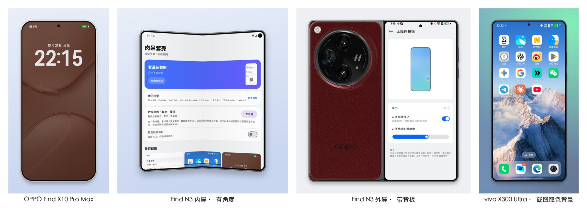

# 肉呆套壳

给手机截图套上真实的机型外框的 Android App。

## 下载

**[⬇ 国内下载（百度网盘，提取码 1234）](https://pan.baidu.com/s/1LIQvDrF9bQ8dTAeo2l__XA?pwd=1234)**

**[⬇ GitHub 下载](https://github.com/rddmwmddr/roudai-taoke-download/releases/latest/download/taoke-full.apk)**

当前版本 1.2.0，要求 Android 10 及以上、64 位 ARM 手机。下载后在手机上打开安装包安装；系统提示「未知来源」时，按提示允许这一次安装。

## 能做什么

- **按截图原分辨率套壳**：圆角、摄像头开孔、中框、侧键按真机参数绘制，放大看也不糊
- **折叠屏三种展示**：内屏「有角度 / 水平」，外屏「带背板 / 单独 / 双色」，背板用品牌官网图
- **背景跟着截图配色**：从截图取色生成「主色 / 撞色 / 柔和」渐变；大小滑条只缩放手机
- **标注与自动打码**：箭头、方框、画笔、文字、马赛克；本机识别手机号、证件号、银行卡、邮箱、验证码、地址、单号和二维码，一键打码
- **截屏后直接点「套壳」**：OPPO 截屏编辑页顶栏、小米和 vivo 截屏浮窗里多一个按钮
- **不下载也能用**：首次打开识别本机只下载这一款；跳过则按截图分辨率自动加边框；保存后可删除原截图

截图只在手机本地处理，不上传。[隐私政策](https://pnc.ahuamiao.com/taoke/privacy.html) · [用户协议](https://pnc.ahuamiao.com/taoke/terms.html)

## 校验

- 安装包 SHA-256：`e00eed14b27ab6694a7f96cddc81b9bb39c2b347b096e5c8bb39fee1c4bb9d81`
- 签名证书 MD5：`EB:91:B9:72:3E:A1:A8:A0:CD:10:D3:2B:F8:5A:47:27`

北京阿花与阿喵文化发展有限公司
